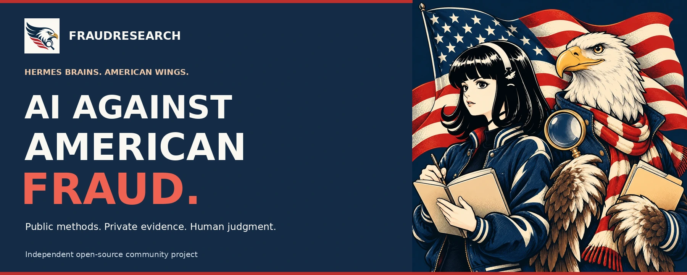
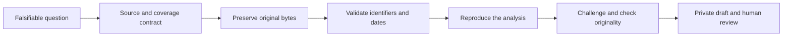

<p align="center"></p>

<p align="center">
  
  
  
  
</p>

<p align="center"><strong>Public methods. Private evidence. Human judgment.</strong></p>
<p align="center"><a href="#quick-start">Quick start</a> · <a href="#use-with-hermes">Hermes profile</a> · <a href="docs/ARCHITECTURE.md">Architecture</a> · <a href="docs/PRIVACY.md">Privacy</a> · <a href="CONTRIBUTING.md">Contribute</a></p>

# AI Against American Fraud

**[Visit the website](https://aiagainstamericanfraud.com/)** | [Meet the artwork and Hermes mashup](site/README.md)

FraudResearch is an independent, open-source research toolkit and [Hermes Agent](https://hermes-agent.nousresearch.com/docs/) profile. Its mission is to help tackle fraud in America with AI, public records, evidence preservation and human review.

It helps researchers preserve sources, resolve identifiers, reconcile amounts, challenge their own assumptions and prepare private, reviewable evidence packages. The goal is better-supported research, not a leaderboard of suspicious people.

> **Research assistance, not a fraud verdict.** This project is not affiliated with the U.S. government. It does not decide guilt, guarantee rewards, file tips or contact subjects. Registry entries, shared addresses and statistical outliers do not establish fraud. **Do not post allegations, personal information or evidence in this repository.**

## Why this exists

Public data can help protect public programs, but disconnected datasets and weak provenance make it easy to draw the wrong conclusion. FraudResearch makes the process explicit: define a question, preserve the original, test the relationship, look for contrary evidence, and state what remains unknown.

The [official fraud portal](https://america.gov/fraud) and [White House fraud page](https://www.whitehouse.gov/fraud/) are public context, not endorsements of this software. Already published enforcement cases are prior-publication context—not discoveries to repackage as new tips. Current written agency terms, not social-media commission claims, govern reward eligibility.

## What you can do

| Capability | What it provides | What it does **not** establish |
|---|---|---|
| Preserve evidence | Original files, URLs, retrieval timestamps, SHA256 and separate extractions | Certified chain of custody or legal admissibility |
| Discover official sources | CMS provider snapshots; bounded NPPES queries; agency references | Complete national claims or recipient-payment coverage |
| Work with bulk data | Bounded CSV/ZIP acquisition, string-preserving Parquet, exact filters and joins | Identity, historical control or misconduct from matching values |
| Check exclusion/ownership sources | CMS hospice ownership/enrollment and OIG exclusion/reinstatement connectors | Complete historical eligibility or actual billed services |
| Reconcile amounts | Decimal sums, counting units, limitations and repeatable calculations | Fraud loss from an unusual total |
| Prepare private drafts | Claim/evidence mapping, quote locators, blockers and attachment manifests | Permission to file or a substantive legal finding |
| Guide research | 13 linked, domain-specific Hermes skills | An autonomous investigator or a security sandbox |

**No evidence datasets, real cases, identifying records, prior investigations, credentials or conversation histories are bundled.** The release contains code, generic methods, documentation, clearly synthetic examples, fictional brand artwork and three dated, attributed government-reported aggregate figures for website context. Those figures are not project findings or recoveries.

## Quick start

Requirements: **Python 3.11+**, [uv](https://docs.astral.sh/uv/) and Git. The offline demo needs no API keys, model access or web services. Linux is the initially verified environment; other platforms require their own acceptance run.

```bash
git clone https://github.com/tylerdotai/fraudresearch.git
cd fraudresearch
uv sync --frozen --group dev
uv run python scripts/demo.py --home "$HOME/.local/share/fraudresearch-demo"
```

Use a new empty directory for each demo run. The example computes a total from two invented records, creates an explicitly incomplete case, exports a private draft, and verifies the attachment manifest. It makes **no network requests from the demo**. Dependency installation can contact package registries.

Selected expected fields—not a real payment result:

```json
{
  "synthetic": true,
  "total": "30.75",
  "draft": true,
  "submitted": false,
  "reward_eligibility": "unknown",
  "manifest_verified": true
}
```

The actual command also prints the private export directory. Open its `report.html` locally; do not upload the generated package to GitHub.

### Start your own private store

```bash
uv run fraudlab init
uv run fraudlab status
uv run fraudlab verify
```

Default data location: `$XDG_DATA_HOME/fraudresearch`, or `$HOME/.local/share/fraudresearch` when XDG is unset. It is **outside the checkout**. Select another private store with `--home` before the subcommand or `FRAUDLAB_HOME`. Strict inspection of an existing store uses `inspect`; ordinary commands can initialize directories/schema. See [command effects](skills/preserve-evidence/references/command-effects.md).

## Use with Hermes

Install [Hermes](https://hermes-agent.nousresearch.com/docs/) separately. Review this source before installing; a profile is not an operating-system sandbox.

```bash
hermes profile install github.com/tylerdotai/fraudresearch --name fraudresearch-starter
hermes -p fraudresearch-starter setup
```

Then sync the workbench in the installed profile. For the standard Hermes home:

```bash
uv sync --frozen --project "$HOME/.hermes/profiles/fraudresearch-starter"
hermes -p fraudresearch-starter chat
```

For a custom Hermes home, use the actual profile path shown by `hermes profile info fraudresearch-starter`. Configure your own model credentials; none are provided. [Setup details](docs/SETUP.md) explain the optional local search/render services. The profile fails closed rather than silently switching to an external web provider.

**Suggested first prompt**

> Load run-investigations. Propose one falsifiable national federal-program research question. State the source population, period, denominator, alternative explanations, missing evidence and stopping rule. Do not submit, contact anyone or treat an anomaly as fraud.

### Included research skills

| Plan and qualify | Analyze and challenge | Preserve and review |
|---|---|---|
| `run-investigations` | `resolve-entities` | `preserve-evidence` |
| `check-program-fit` | `analyze-payments` | `review-originality` |
| `discover-national-sources` | `trace-federal-funds` | `challenge-findings` |
| `research-healthcare` | `research-medicaid` | `prepare-case-files` |
| `research-care-services` | | |

## The research workflow



Each step can end with **revise, stop or no supported finding**. That is a valid outcome. No automatic publication, government reporting, messaging or scheduled research is included.

## Official-source connectors

See [SOURCE-REGISTRY.json](SOURCE-REGISTRY.json) for exact implementation boundaries. No source is preloaded.

```bash
# Explicit network acquisition; may download identifying public records.
uv run fraudlab bulk connector cms-hospice-chow --max-bytes 20000000 --max-rows 200000
uv run fraudlab bulk verify
```

Other bulk connectors: `cms-hospice-owners`, `cms-hospice-enrollments`, `oig-leie`, `oig-reinstatements`. The ordinary connector supports `cms-hospice`, `cms-home-health`, bounded `nppes`, and `agencies` (an agency reference only, **not award-level spending**).

Source schemas, access and publication schedules can change. Current snapshots do not prove historical continuity. Public records may contain personal identifiers; minimize their use and keep them out of issues, pull requests, prompts and public reports unless specifically justified and authorized.

## Privacy and safety

- Source release and private runtime data are separate.
- The release uses an explicit file allowlist, text-pattern checks and SHA256 manifests.
- Defaults contain no credentials or machine-specific service endpoints.
- Search and rendering are optional, operator-configured loopback services.
- Public acquisition is limited to credential-free HTTPS on public `.gov` hosts; no login/CAPTCHA bypass.
- DuckDB has fixed resource limits, no arbitrary user SQL and no automatic extension installation.
- Source documents are untrusted data, never executable instructions.

**Local storage is not a promise of zero outbound data.** Model providers can receive prompts and context; search engines receive queries; crawlers and source websites receive requests. DNS preflight is not hardened browser/subresource isolation. Read the [privacy and data-flow guide](docs/PRIVACY.md) and [security policy](SECURITY.md).

## Verify the toolkit

PDF regression contracts require `pdftotext` from Poppler to already be available. The project does not install system packages or OCR automatically.

```bash
uv run ruff check .
uv run mypy src
uv run python tests/e2e.py
uv run python tests/upgrade_e2e.py deterministic
uv run python scripts/check_skills.py
uv run python tests/release_e2e.py
```

Tests use labelled synthetic data in disposable scratch stores and write repeatable JSON receipts under ignored `artifacts/`. Raw receipts can contain local paths; **do not publish them**. Live network acceptance is separate. See [verification](docs/VERIFICATION.md) and the [release contract](docs/RELEASE-CONTRACT.md).

## Help improve the methods

Useful contributions include source-contract corrections, date-aware identifier handling, better falsification examples, accessibility and synthetic E2E reproductions. Read [CONTRIBUTING.md](CONTRIBUTING.md). This repository is for software and methods—not public accusations or tip intake.

## License and disclaimer

[MIT](LICENSE) for this software. Dependencies retain their own licenses; source agencies govern access and reuse of their datasets. No evidence datasets or government seals are redistributed. The website attributes a dated aggregate context snapshot to America.gov. No legal advice, government affiliation, award eligibility, project recovery amount or fraud determination is implied.
